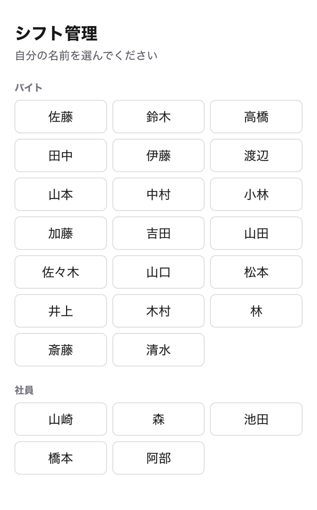
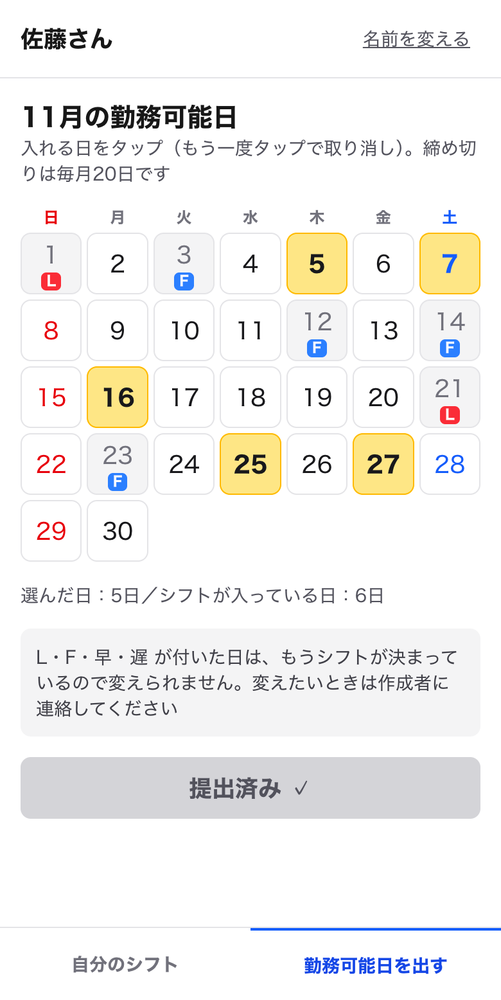
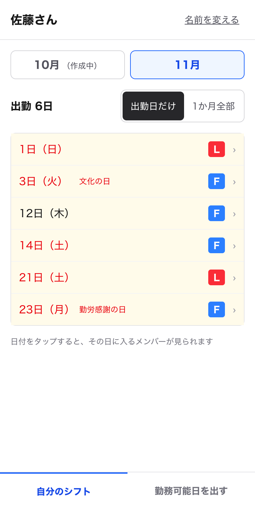
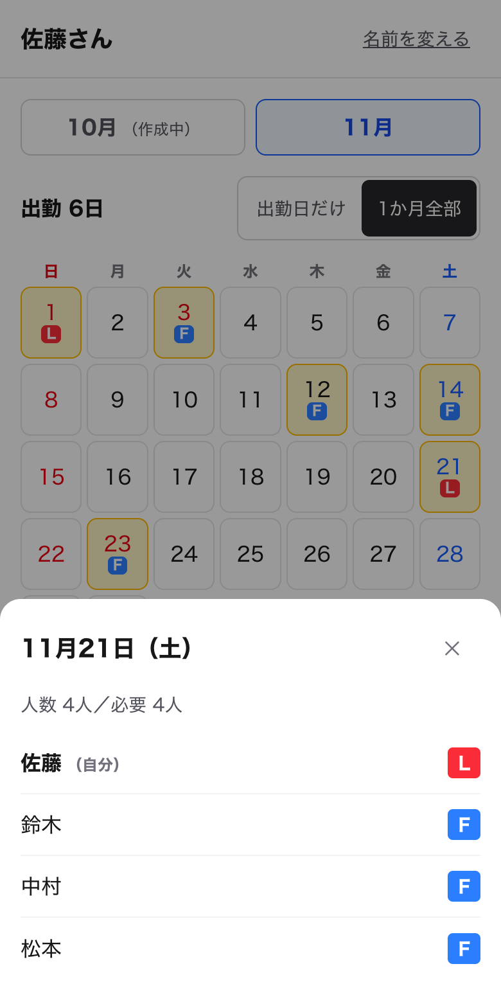
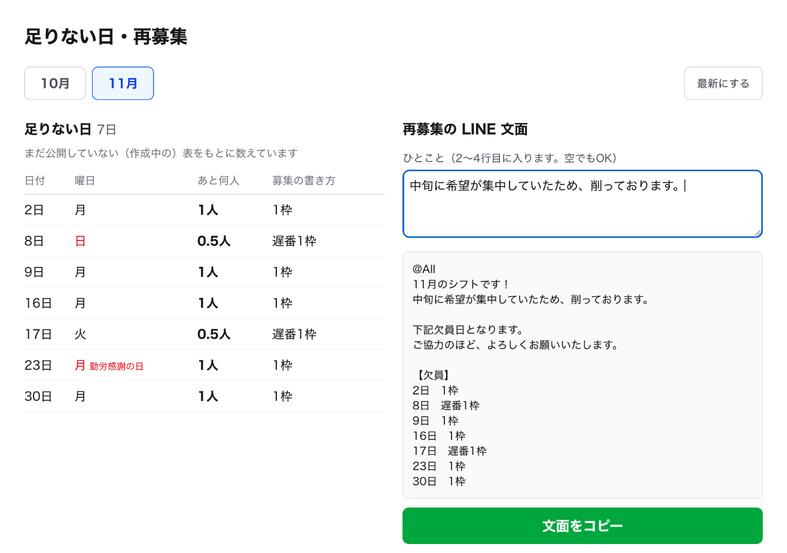

# シフト管理アプリ（バイト向け）

アルバイト先のシフトづくりを手伝う Web アプリです。バイトはスマホで勤務可能日を出して自分のシフトを確認でき、シフト作成者はいつもの Google スプレッドシートのまま、人数の過不足と再募集の文面がすぐに分かります。

**公開 URL：https://shift-app-zeta-one.vercel.app/**（作成者用の画面は [/admin](https://shift-app-zeta-one.vercel.app/admin)）

> 公開しているデータはすべてダミーです（名前は日本に多い名字を使っています）。

## なぜ作ったか

モデルにしたバイト先では、約20人のバイトが勤務可能日を個別の LINE でシフト作成者に送り、作成者がそれをスプレッドシートに手で入力しています。

| 立場 | 困りごと | このアプリでの解決 |
|---|---|---|
| シフト作成者 | 全員の勤務可能日を1件ずつ手入力している | バイトがアプリで出すと、スプシのセルが自動で薄い黄色になる |
| シフト作成者 | 日ごとに人数が足りているか一目で分からない | 人数を自動で数え、足りない／ちょうど／多すぎるを色分け（祝日も自動判定） |
| シフト作成者 | 足りない日を毎回自分で探して再募集している | 足りない日の一覧と、LINE にそのまま貼れる再募集の文面をワンタッチでコピー |
| バイト | 横長の表で自分の行が見にくい | 自分のシフトだけを縦の一覧・カレンダーで見られる |
| バイト | 同じ日にだれが入るかすぐ分からない | 日付をタップすると、その日のメンバーが出る |

## 画面

| 名前を選ぶ | 勤務可能日を出す | 自分のシフト（一覧） |
|---|---|---|
|  |  |  |

| 自分のシフト（カレンダー） | その日のメンバー |
|---|---|
|  |  |

**作成者用：足りない日・再募集（/admin）**



## できること

**バイト（スマホ）**
- 名前を選ぶ（スマホが覚えるので次からは選ばずに開ける）
- 翌月の勤務可能日をカレンダーでタップして提出・出し直し
  - 作成者がもうシフト（L/F/早/遅）を入れた日と、「公開する」で確定した月は変えられない
- 自分のシフトを「出勤日だけ」の一覧と「1か月全部」のカレンダーで切り替えて見る（公開前は「作成中」）
- 日付をタップして、その日に入るメンバーと人数を見る

**シフト作成者（パソコン）**
- いつもどおりスプシで L（リーダー）・F（フルタイム）・早・遅 を打つと、色が自動で付く
- 日ごとの人数（L・F＝1人、早・遅＝0.5人）を自動で数え、必要人数（平日3人・土日祝4人）と比べて色分け
- 「公開する」にチェックを入れると、バイトのアプリにシフトが出る
- アプリの /admin で足りない日の一覧を見て、再募集の LINE 文面をコピー

## しくみ

```
バイトのスマホ ──▶ Next.js（Vercel）の /api ──▶ Apps Script（ウェブアプリ） ──▶ Google スプレッドシート
作成者のパソコン ─────────────────────────────────────────────────────────▶ （いつもどおり直接編集）
```

- データはすべて Google スプレッドシートに置いています（データベースは使っていません）
- Apps Script の URL はサーバー側（Route Handler）からだけ呼び、ブラウザには出しません
- スプシ側の色付け・人数計算・祝日の判定・翌月シートの作成は、Apps Script とスプシの数式・条件付き書式で行います。祝日は Google カレンダーの「日本の祝日」から取っています

## 技術スタック

| 分類 | 使ったもの |
|---|---|
| 画面 | Next.js 16（App Router）／React 19／TypeScript／Tailwind CSS v4 |
| データ | Google スプレッドシート |
| つなぎ | Google Apps Script（ウェブアプリとして公開） |
| 公開 | Vercel（Hobby プラン） |
| 開発 | Claude Code（`/init`・Plan Mode・Claude in Chrome） |

すべて無料のサービスだけで動いています。

## フォルダの中身

```
apps-script/Code.gs   … Apps Script のコード（スプシの「拡張機能 → Apps Script」に貼って使う）
src/app/              … 画面（/・/me・/me/availability・/admin）と API（/api/...）
src/components/       … 画面の部品
src/lib/              … 人数の数え方のルール・日付・Apps Script を呼ぶ処理
docs/requirements.md  … 要件定義書（仕様の正本）
```

## 自分の環境で動かす

1. **スプレッドシートを用意する**
   1. Google スプレッドシートを新しく作り、「ファイル → 設定」でロケールを「日本」、タイムゾーンを「東京」にする
   2. 「拡張機能 → Apps Script」を開き、`apps-script/Code.gs` の中身を貼り付けて保存する
   3. 関数 `setupSpreadsheet` を実行する（名簿・ひな形・翌月のシートができる）
   4. 「デプロイ → 新しいデプロイ → ウェブアプリ」で、実行するユーザー＝自分、アクセスできるユーザー＝全員にしてデプロイし、URL をコピーする
2. **アプリを動かす**
   ```bash
   npm install
   echo 'APPS_SCRIPT_URL=コピーしたURL' > .env.local
   npm run dev   # http://localhost:3000
   ```
3. **Vercel に公開する**：リポジトリを Vercel に読み込み、環境変数 `APPS_SCRIPT_URL` を設定してデプロイする

> Apps Script のコードを直したときは、「デプロイを管理 → 編集 → 新バージョン」でデプロイし直さないと反映されません。

スプシのメニュー「シフト → サンプルを入れる」で、デモ用の L/F/早/遅 を入れられます。

## これから（v1.0 以降）

- パスキー（指紋・顔認証）でのログイン（今は名前を選ぶだけ）
- 締め切り（毎月20日）の表示と入力ロック、未提出の人の一覧
- 入れない日への割り当てやリーダーがいない日の警告
- LINE 通知、シフト案の自動作成
