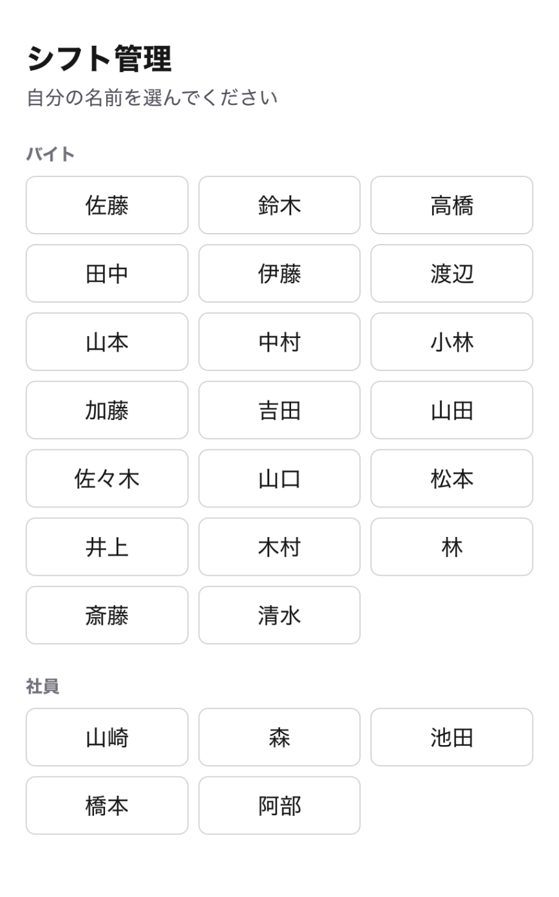
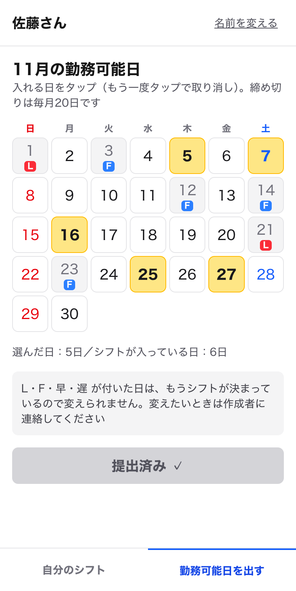
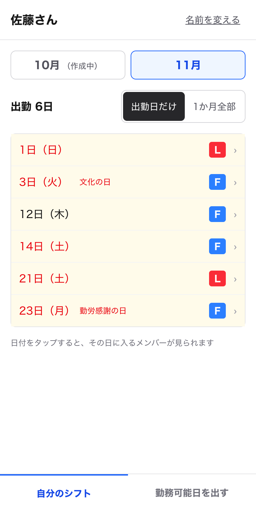
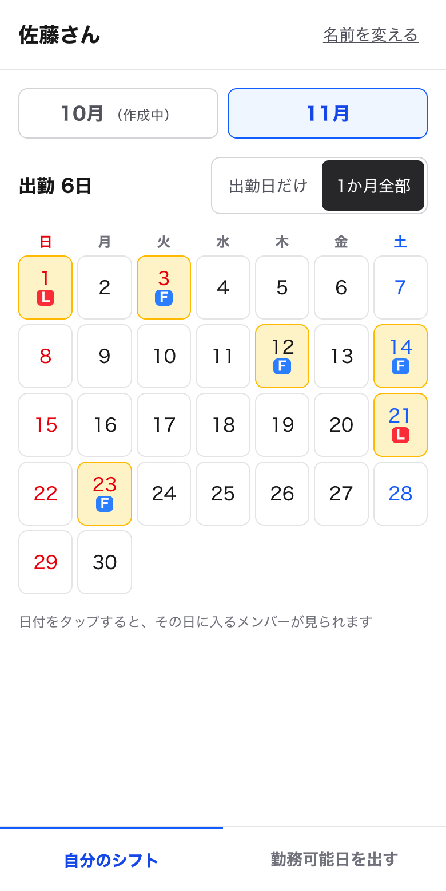
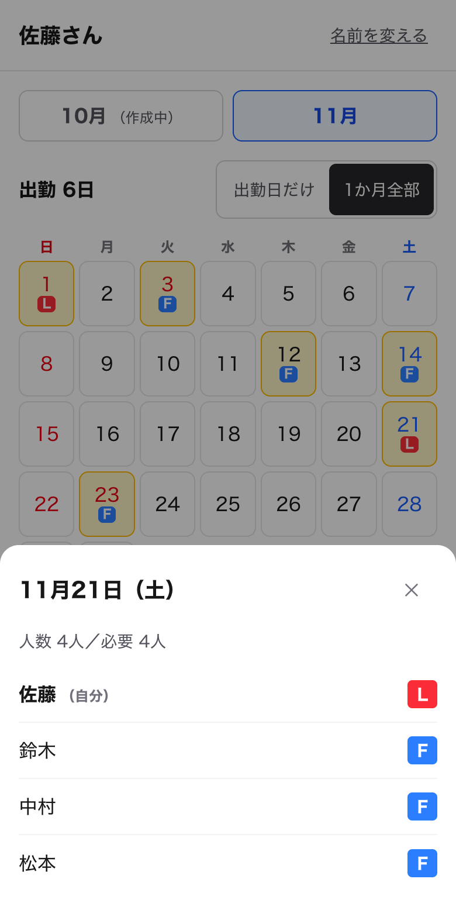
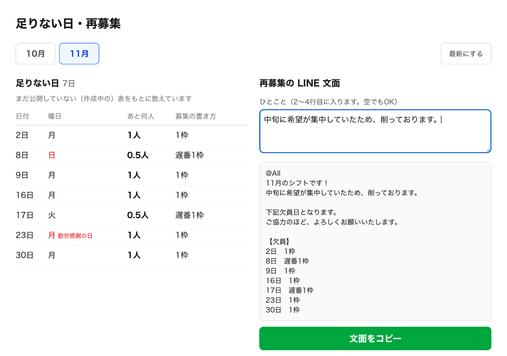
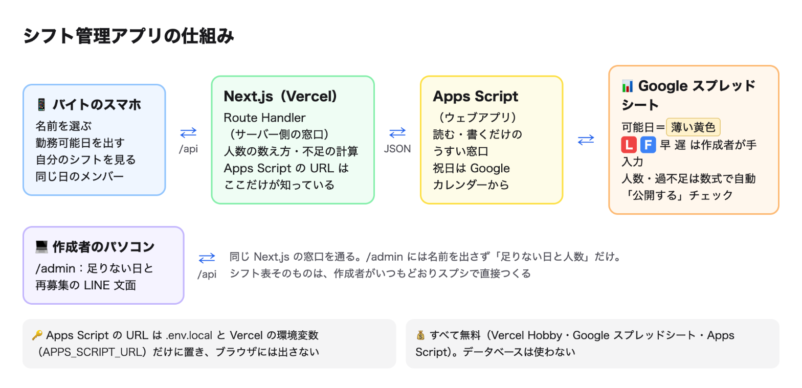

# [課題提出] バイト先のシフト管理アプリ（オリジナルシステム開発）を完成させました

> このファイルは提出記事の原稿です（`zsh docs/copy_article.sh` で写真ごとコピーできます）。

## A. 課題概要

### 課題情報

- 課題名：実践編 Section 1-3　オリジナルシステム開発（要件定義書をもとに、Claude Code でシステム・ツールを作ろう）
- 難易度：★★★★☆（5段階で自己評価）

### 課題要件

- 要件定義書をベースに開発する（誰の・何を・どう解決するかを明確にする）
- CLAUDE.md を `/init` で生成し、プロジェクト固有のルールを追記する
- Plan Mode で設計 → 確認 → 実装の順に進める
- Vercel にデプロイして公開 URL を取得する
- GitHub リポジトリを公開し、README にスクショと技術スタックを載せる
- システム・ツール記事を公開する（誰のため／技術スタック／使った Claude Code 機能／つまずき／公開 URL／GitHub URL）

### ソースコード

- GitHub：https://github.com/Usuke3122378/shift-app
- Google Drive：なし
- 公開URL：https://shift-app-zeta-one.vercel.app/ （作成者用の画面は https://shift-app-zeta-one.vercel.app/admin ）

### 誰のためのツールか

自分が働いているバイト先がモデルです。自分はシフトに入るバイト側です。

- **シフト作成者（社員の1人・パソコン）**：約20人のバイトから個別の LINE で届く勤務可能日を、1件ずつスプレッドシートに手で入力しています。人が足りない日は、自分で探して毎月もう一度募集をかけていて、大変そうでした
- **バイト（約20人・スマホ）**：LINE で届くシフト表の画像は横長で、自分の行が見にくいです。同じ日にだれが入るかもすぐには分かりません

そこで、作成者が**いつものスプレッドシートのまま**使えて、バイトは**スマホで出して・見るだけ**のアプリにしました。

| 立場 | 困りごと | このアプリでの解決 |
|---|---|---|
| シフト作成者 | 全員の勤務可能日を1件ずつ手入力している | バイトがアプリで出すと、スプシのセルが自動で薄い黄色になる |
| シフト作成者 | 日ごとに人数が足りているか一目で分からない | 人数を自動で数え、足りない／ちょうど／多すぎるを色分け（祝日も自動判定） |
| シフト作成者 | 足りない日を毎回自分で探して再募集している | 足りない日の一覧と、LINE にそのまま貼れる再募集の文面をワンタッチでコピー |
| バイト | 横長の表で自分の行が見にくい | 自分のシフトだけを縦の一覧・カレンダーで見られる |
| バイト | 同じ日にだれが入るかすぐ分からない | 日付をタップすると、その日のメンバーが出る |

※ 公開しているデータはすべてダミーです。お店の本物のシフト表にはつないでいません。名前も日本に多い名字を使ったダミーの名簿です。

### 成果物のスクリーンショット

最初に開く「名前を選ぶ」画面（スマホ）。一度選ぶとスマホが覚えるので、次からは選ばずに開ける

翌月の勤務可能日を出す画面。入れる日をタップすると黄色になり、「提出する」でスプシの自分の行が薄い黄色になる。作成者がもう L・F を入れた日はグレーになり、変えられない

自分のシフト（出勤日だけ）。作成者がスプシで「公開する」にチェックを入れると表示される。L＝赤、F＝青。祝日には名前も出る。公開前の月は「作成中」

「1か月全部」に切り替えると、カレンダーで出勤日に色が付く

日付をタップすると、下からその日のメンバーが出る。人数（L・F＝1人、早・遅＝0.5人）と必要人数も表示する

作成者用の画面（パソコン）。足りない日の一覧と、再募集の LINE 文面。「ひとこと」を書き足して「文面をコピー」を押せば、そのまま LINE に貼れる。名前は出さない

【スクショ：Google スプレッドシートの「2026-11」シート（黄色の可能日・赤の L・青の F・充足可否の行が見える画面）】

## B. 実装内容

### 使用技術

- 言語：TypeScript、Google Apps Script（JavaScript）
- フレームワーク：Next.js 16（App Router、Route Handler）、React 19、Tailwind CSS v4
- データベース：なし（データはすべて Google スプレッドシート）
- その他ツール：Google スプレッドシート（シフト表。数式と条件付き書式で人数計算・色付け）、Google Apps Script（スプシを読み書きする窓口。ウェブアプリとして公開）、Google カレンダーの「日本の祝日」（祝日の判定）、Claude Code（設計・実装・動作確認・スクショ撮影）、GitHub（コード保管）、GitHub CLI（gh。リポジトリ作成と push）、Vercel（Hobby プラン。公開と環境変数の設定。push すると自動で公開し直す）
- 費用：**0円**（すべて無料のサービスだけで動いています）

### 使った Claude Code の機能

| 機能 | 使い方 |
|---|---|
| `/init` と CLAUDE.md | プロジェクトの説明書（CLAUDE.md）を自動で作り、そこにプロジェクト固有のルールを7つ追記した（下の表） |
| Plan Mode | コードを書く前に、ファイル構成・Apps Script の関数・スプシの数式・作る順番・自分が手でやる作業を計画してもらい、確認してから実装に入った |
| 要件定義書を読ませる | `docs/requirements.md` を「仕様の正本」にして、決まったことや進み具合を Claude Code に随時書き足してもらった |
| Claude in Chrome | Chrome を操作して、公開版の動作確認と README・記事のスクショ撮影をしてもらった（スマホ幅 390px で撮影） |
| 1ステップずつコミット | 区切りごとに lint・ビルド・動作確認をしてからコミットしてもらった |

CLAUDE.md に追記したルール：

| ルール | ねらい |
|---|---|
| 返答・説明はすべて日本語。専門用語には短い説明を付ける | 初心者でも分かるように |
| 仕様は `docs/requirements.md` が正 | 話がずれないように、決まったことはここに書き足す |
| 有料 API・有料サービスは使わない | すべて無料で作る |
| 本名をコード・スプシ・スクショ・記事に入れない | 公開するので、ダミーの名簿を使う |
| Apps Script の URL は `.env.local` の `APPS_SCRIPT_URL` に置き、`NEXT_PUBLIC_` は付けない | 付けるとブラウザに漏れてしまう |
| バイト用はスマホ（375px）優先・ボタンは44px以上、作成者用はパソコン優先 | 使う人の端末に合わせる |
| 1ステップずつ進め、区切りごとに動作確認してからコミット | 壊れたときに戻りやすくする |

### 実装した機能

1. 名前を選ぶ（バイト）：スプシの「名簿」シートの名前がボタンで並ぶ。選んだ名前はスマホに保存し、次からは自分のシフトの画面がすぐ開く
2. 勤務可能日の提出（バイト）：翌月のカレンダーで入れる日をタップして提出すると、スプシの自分の行のセルが薄い黄色になる。出し直しは上書き。作成者がもう L/F/早/遅 を入れた日と、「公開する」で確定した月は変えられない
3. 自分のシフト（バイト）：今月・来月を切り替え、「出勤日だけ」の一覧と「1か月全部」のカレンダーで見られる。公開前の月は「作成中」
4. その日のメンバー（バイト）：日付をタップすると、下から出る小窓にその日のメンバーと L/F/早/遅、人数と必要人数が出る
5. スプシの自動処理（作成者）：L＝赤・F＝青の色付け、日ごとの人数の計算（L・F＝1人、早・遅＝0.5人）、必要人数（平日3人・土日祝4人）との比較で「✕・○・多」の色分け、出勤日数、祝日の判定、翌月シートの自動作成
6. 足りない日の一覧と再募集の文面（作成者）：足りない日を「日付・曜日・あと何人」で表示し、いつも使っている LINE の書き方（「2日　1枠」「8日　遅番1枠」）で文面を作ってコピーできる

### 工夫したポイント

- 作成者は**新しい画面を覚えなくていい**ようにしました。シフトはいつもどおりスプシで L・F を打つだけです。アプリから出た勤務可能日は、セルの**背景色（薄い黄色）**として記録します。L・F の色は「条件付き書式」（セルの中身に応じて自動で色を付けるスプシの機能）で付けるので、黄色と L・F の色が上書きし合いません。
- Apps Script の URL がブラウザから見えないようにしました。画面 → Next.js のサーバー側の窓口（`/api/...`）→ Apps Script → スプシ の順に中継し、URL は環境変数 `APPS_SCRIPT_URL` にだけ置いています。公開版の HTML と JavaScript に URL が入っていないことも確認しました。
- 作成者用の `/admin` はログインなしなので、**名前を出さず**「足りない日と人数」だけを表示するようにしました。
- 人数の数え方のルール（必要人数・0.5人の数え方・「遅番1枠」の書き方）は、`src/lib/shift-rules.ts` の1か所にまとめました。
- 祝日は Google カレンダーの「日本の祝日」から取っています。ただし、カレンダーには七五三などの記念日も入っているので、**国民の祝日の名前だけ**を祝日として扱います。
- 作成者がスプシでシフトを入れたら、バイトの画面にすぐ反映されるようにしました。画面に戻ってきたときと30秒ごとに読み直します。

## C. 実装過程

### 開発の流れ

#### 10月30日〜31日（1）要件定義書を作る

やったこと：教材（T-04 ユーザーストーリーマップ・T-05 情報設計・T-06 要件定義書）に沿って、Claude Code と相談しながら `docs/requirements.md` を作った。背景・困りごと・ペルソナ・人数の数え方・機能一覧（F-01〜F-22）・ページ一覧・スプシの形を決め、MVP／v1.0／v2.0 に分けた。

遭遇したエラー：`（エラーはなし）`

Cursorに聞いた内容：（Claude Code に）実際のシフト表のスクショと、作成者がいつも送っている再募集の LINE の文面を見せて、どう作ればよいか相談した。

Cursorの回答：（Claude Code の回答）作成者は今のスプシをそのまま使い、バイトはアプリで出して・見るだけにすると、作成者が新しいことを覚えなくて済む。ログインは後回し（v1.0）にして、MVP は名前を選ぶだけにする。公開するので本名は使わず、ダミーの名簿を作る。

実際に試したこと：

1. 決まったことを要件定義書に書き足しながら、Step 1〜7 を順に進めた
    - 結果：10月31日の朝に要件定義が確定した

学んだこと：「誰が・どの端末で・今どうやっているか」を先に決めると、作る画面が自然に絞れる。

---

#### 10月31日（2）`/init` で CLAUDE.md を作り、Plan Mode で設計する

やったこと：Next.js のプロジェクト shift-app を作り、`/init` で CLAUDE.md を作った。そこに自分で考えた7つのルール（日本語・無料・ダミーの名簿・URL を隠す・画面の幅・1ステップずつコミットなど）を追記した。そのあと Plan Mode で、手順3〜5（スプシ＋Apps Script、バイト用画面、作成者用画面）の計画を立ててもらった。

遭遇したエラー：`（エラーはなし）`

Cursorに聞いた内容：（Claude Code の Plan Mode で）「要件定義書を読んで、ファイル構成と役割・Apps Script の関数とアプリとのやりとり・スプシの数式と条件付き書式と祝日の判定・作る順番・私が手でやる作業を計画して」と頼んだ。

Cursorの回答：（Claude Code の回答）Apps Script は「読む・書く」だけの薄い窓口にし、人数の計算や LINE 文面づくりは Next.js 側で行う（Apps Script は直すたびにデプロイし直しが必要で、確認もしにくいため）。スプシの数式・条件付き書式・チェックボックスは、手でクリックして作らず、`setupSpreadsheet()` を1回実行すれば自動でできるようにする。

実際に試したこと：

1. 計画を読んで OK を出し、自分はスプシを作って Apps Script を貼り付け、`setupSpreadsheet` を実行してウェブアプリとしてデプロイした
    - 結果：「名簿」「ひな形」「2026-11」のシートができ、URL を開くと名簿の JSON が返ってきた

学んだこと：計画の段階で「自分が手でやる作業」まで書いてもらうと、待ち時間なく進められる。

---

#### 10月31日（3）祝日の行に「七五三」が入り、セルからはみ出した

やったこと：Apps Script で、Google カレンダーの「日本の祝日」から祝日を取って、シートの4行目に書き込んだ。

遭遇したエラー：`（エラーはなし）祝日の行に「七五三」が入っていた。祝日の名前が長く、セルからはみ出していた`

Cursorに聞いた内容：（Claude Code に）「七五三という記念日が入っています。記念日がセルからはみ出しているのが気になります」と伝えた。

Cursorの回答：（Claude Code の回答）「日本の祝日」のカレンダーには、七五三や節分のような祝日ではない記念日も入っている。国民の祝日の名前の一覧と照らし合わせて、それだけを祝日にする。セルには「祝」とだけ書き、祝日の名前はセルのメモに入れる。

実際に試したこと：

1. Apps Script を直して、「デプロイを管理 → 新バージョン」でデプロイし直した
    - 結果：七五三が消え、文化の日・勤労感謝の日だけが「祝」になった

学んだこと：外から取ってきたデータは、そのまま使わずに中身を確かめる。Apps Script はコードを直したら、デプロイし直さないと反映されない。

---

#### 10月31日（4）L を入れた日をアプリで外すと、スプシに L が残る

やったこと：アプリで勤務可能日を提出し、スプシでその日に L を入れた。そのあとアプリで、その日を外して出し直した。

遭遇したエラー：`（エラーはなし）アプリ上は白くなるが、スプシには L が残ったままになる`

Cursorに聞いた内容：（Claude Code に）起きたことをそのまま伝えた。

Cursorの回答：（Claude Code の回答）「出し直しても作成者が入れた L/F は消さない」というルールどおりの動きだが、アプリとスプシで見え方が食い違ってしまう。①そのまま ②アプリで外せなくする ③外したら L も消す、のどれにするか選んでほしい（おすすめは②）。

実際に試したこと：

1. 「アプリで外せなくする」を選んだ。L/F/早/遅 が入った日はグレーになって押せなくなり、「作成者に連絡してください」と出るようにした。Apps Script 側でも、その日のセルは変えないようにした
    - 結果：アプリとスプシの見え方がそろった。要件定義書の F-03 にもこのルールを書き足した

学んだこと：仕様どおりでも、使う人が混乱する動きは直す。どう直すかの判断は自分でする。

---

#### 10月31日（5）名前を切り替えると、前の人の日付が一瞬出る

やったこと：佐藤さんで提出したあと、「名前を変える」で別の人に切り替えて勤務可能日の画面を開いた。

遭遇したエラー：`（エラーはなし）別の人の画面なのに、佐藤さんの選んだ日付が3秒ほど出てから消える`

Cursorに聞いた内容：（Claude Code に）「他の人で入力しようとすると佐藤さんの選んだ日付が一瞬出て3秒くらいして消えます。これはなくしたい」と伝えた。

Cursorの回答：（Claude Code の回答）この版の Next.js（`cacheComponents` が有効）は、ページを移動しても前の画面の状態を残しておく。そのため、新しい人のデータが届くまで前の人の状態が見えていた。名前と月が変わったら、カレンダーの部品を作り直す（`key` に名前と月を入れる）。

実際に試したこと：

1. 直してから、名前を何回か切り替えて確かめた
    - 結果：前の人の日付が出なくなった

学んだこと：Next.js は新しい版で動きが変わっているので、Claude Code には手元の `node_modules/next/dist/docs/` の説明書を読んでから書いてもらう（CLAUDE.md にも書いてある）。

---

#### 10月31日（6）提出したあとにスプシで L を入れても、アプリに反映されない

やったこと：アプリで提出したあと、画面を開いたままスプシでその日に L を入れた。

遭遇したエラー：`（エラーはなし）アプリに L が出ず、その日をまだ外せてしまう。直したあとは、追加で選んだ日が「選んだ日」の数に入らなくなった`

Cursorに聞いた内容：（Claude Code に）「提出ボタン押下後スプシで L や F を入れた場合、即時にアプリに反映されず修正できるようになっています」と伝えた。

Cursorの回答：（Claude Code の回答）画面は最初に読み込んだときのままだった。提出したときにスプシの最新の状態を返し、さらに画面に戻ってきたときと30秒ごとに読み直す。選び途中の日は残し、シフトが入った日だけスプシにそろえる。「選んだ日」の数は、黄色の日だけを数え、シフトが入っている日は別に数える。

実際に試したこと：

1. 直したあと、Chrome で「提出 → スプシで L → アプリに戻る → 日を追加」を試してもらった
    - 結果：L がすぐ出て押せなくなり、「選んだ日：5日／シフトが入っている日：6日」のように正しく数えられた

学んだこと：2人（バイトと作成者）が同じデータを触るアプリは、「相手が途中で変えたとき」を必ず試す。

---

#### 10月31日（7）「1か月全部」をカレンダーに、公開後は全部変えられないように

やったこと：自分のシフトの「1か月全部」を見た。また、「公開する」で確定したあとに勤務可能日の画面を開いた。

遭遇したエラー：`（エラーはなし）「1か月全部」が縦に長い一覧で見にくい。確定したあとでも、シフトに入っていない日を黄色にしたり消したりできた`

Cursorに聞いた内容：（Claude Code に）「1か月全部はカレンダー形式がいい」「公開するで確定した後、たとえシフトに入っていなくてもそこを動かされるのは気持ち悪い」と伝えた。

Cursorの回答：（Claude Code の回答）「1か月全部」は勤務可能日と同じ形のカレンダーにし、出勤日に色を付ける。確定した月は、画面を見るだけにして提出ボタンを隠す。Apps Script 側でも、確定した月の提出は「この月のシフトは確定しているので変更できません」と断る。

実際に試したこと：

1. 公開チェックを入れたり外したりして、両方の画面を確かめた
    - 結果：確定後は見るだけになり、カレンダー表示も見やすくなった

学んだこと：画面だけでなくサーバー側（Apps Script）でも止めておくと、確実に守れる。

---

#### 10月31日（8）GitHub と Vercel で公開する

やったこと：Claude Code に Public のリポジトリ shift-app を作って push してもらった。Vercel で Import し、Environment Variables に `APPS_SCRIPT_URL` を自分で登録してから Deploy した。

遭遇したエラー：`（エラーはなし）`

Cursorに聞いた内容：（Claude Code に）「shift-app で公開して。Vercel の処理もできるところまでやって」と頼んだ。

Cursorの回答：（Claude Code の回答）GitHub に上げる前に、`.env.local` が上がらない設定になっていることと、URL がコードに入っていないことを確認した。秘密の URL は自分では入力しないので、Vercel の環境変数への登録はお願いしたい。

実際に試したこと：

1. 公開URLを伝えて、Claude Code に確認してもらった
    - 結果：全ページが表示され、API も動いた。公開版の HTML と JavaScript に Apps Script の URL が入っていないことも確認できた

学んだこと：秘密の値は AI に打ち込ませず、自分で登録する。公開したら「漏れていないか」まで確かめる。

---

#### 10月31日（9）README のスクショを撮る

やったこと：Claude Code に、Claude in Chrome で公開版のスクショを撮ってもらった。スプシで「シフト → サンプルを入れる」を押してデモ用の L/F を入れ、勤務可能日と /admin を撮ったあと、「公開する」にチェックして自分のシフトを撮った。

遭遇したエラー：`（エラーはなし）ブラウザの幅を変える操作が効かず、スマホの幅で撮れなかった。「サンプルを入れる」で、名前のない空の行にまで L/F が入った`

Cursorに聞いた内容：（Claude Code が撮ったスクショを確認）

Cursorの回答：（Claude Code の回答）ページの中に幅390pxの枠（iframe）を作って、その中にアプリを表示して撮る。サンプルが空の行に入ったのは、「日数」の列の数式が40行目まであり、最後の行を40行目と判断していたため。名前が入っている行だけに入れるように直す。

実際に試したこと：

1. 幅390pxの枠の中で、6枚のスクショを撮り直してもらった
    - 結果：スマホで見たときと同じ画面が撮れた

学んだこと：スクショを撮ると、テストでは気づかなかった不具合（空の行へのサンプル）が見つかる。

---

### 参考にした資料

- 公式ドキュメント：Next.js の「Route Handlers」「Cache Components」（プロジェクト内の node_modules/next/dist/docs）、Google Apps Script のウェブアプリ・SpreadsheetApp・CalendarApp・LockService のリファレンス
- 参考記事：
- 動画教材：実践編 T-04（ユーザーストーリーマップ）・T-05（情報設計）・T-06（要件定義書）

## D. 学習の振り返り

### 今回学んだこと

技術的な学び：

- データベースを使わなくても、Google スプレッドシート＋Apps Script（ウェブアプリ）で読み書きできる窓口が作れる
- 「勤務可能日＝セルの背景色」「L/F の色＝条件付き書式」のように役割を分けると、作成者の入力とアプリの入力がぶつからない
- Apps Script の URL も API キーと同じく秘密の値。Next.js のサーバー側（Route Handler）から呼び、`NEXT_PUBLIC_` は付けない
- この版の Next.js は、ページを移動しても前の画面の状態を残す。人が切り替わる画面では、`key` で作り直す
- 2人が同じデータを触るときは、画面を開いたままでも最新の状態に読み直すしくみが必要

AIツールの使い方：

- 要件定義書を「仕様の正本」にして、決まったことを AI に随時書き足してもらうと、途中で話がずれない
- CLAUDE.md に自分のルール（日本語・無料・本名を出さない・URL を隠す）を書いておくと、毎回言わなくても守ってくれる
- Plan Mode で「自分が手でやる作業」まで計画してもらうと、AI とやることを分けられる
- 不具合は「何をしたら、どうなったか」をそのまま伝えると、原因と直し方の選択肢を出してもらえる。どれにするかは自分で決める
- Claude in Chrome で動作確認とスクショをまとめて頼める。秘密の値の入力は AI にさせず自分でやる

開発の進め方：

- 要件定義 → Plan Mode で設計 → 1ステップずつ実装・確認・コミット、の順で進めると、1日で公開まで進められた
- 画面を実際に触ると、仕様どおりでも「気持ち悪い」動きが見つかる。そのたびに要件定義書も更新した

### 作った機能からの発展アイデア

今回作った機能：足りない日の一覧と、再募集の LINE 文面のコピー

発展アイデア：「足りない日に入れそうな人を、勤務可能日から自動で探して知らせる機能」

- どんな人に：毎月、人が足りない日の再募集をしているシフト作成者
- どんな時に：シフトを組み終わって、足りない日が残ったとき
- どんなメリットがあるか：その日に「入れる」と出していたのにまだシフトに入っていない人や、出勤日数が少ない人が一覧で分かる。全員に再募集を送る前に、入れそうな人に直接声をかけられるので、早く埋まる

### 次の課題に向けて

- v1.0 として、パスキー（指紋・顔認証）でのログインを入れ、なりすましを防ぎたい
- 締め切り（毎月20日）の表示と入力ロック、未提出の人の一覧を作りたい
- ホーム画面に追加してアプリのように開けるようにし、実際のバイト先で使ってもらえるか相談したい

---

📝 追加メモ

- 公開しているデータはすべてダミーです（お店の本物のシフト表にはつないでいません。名前もダミーの名簿です）
- Apps Script の URL は .env.local（GitHub には上げていません）と Vercel の Environment Variables で管理しています。コードには書いていません
- スクショのシフトは、スプシのメニュー「シフト → サンプルを入れる」で入れたデモ用のものです
- 公開URLは GitHub と連携しているので、push するたびに自動で更新されます
